I was waiting to tell you about ShowBook. I wanted it to be a surprise.

I wanted to get through its first real event so I could tell you what it actually did for someone, not what I hoped it would do.

Instead, I'm writing about shutting it down.

...Surprise!

After the initial discovery and a March deposit, I spent six months building software to help live-event producers turn meeting transcripts, emails, and spreadsheets into a production schedule their crews could rely on. I had a paying customer, real documents to build against, regular meetings, and more feature ideas than I could possibly finish.

Then my customer found a way to do most of the work with Claude and Google Sheets.

The easy headline is "AI killed my startup." That's part of the story. But it leaves out the warning signs, why I thought purpose-built software would still win, and the part of the experience I actually wanted most.

## This time, someone paid

ShowBook wasn't my first attempt at building a software business.

There was SubAligner, where I ran into the limits of a small market. AV Sync, where I couldn't establish clear demand. GainGuardian, where technical challenges and the lack of a clear path to market stopped me. I've written about [how those projects went](https://nathanlively.substack.com/p/six-months-audio-physics-reddit-validation-almost-brokehtml).

With AV Sync, I kept trying to build a product by consensus. Business books say to talk to customers about their problems, so I talked to customers about their problems. More than 50 AV managers. When I couldn't find enough overlap, I did more interviews.

I thought I was being diligent. I was also hoping that if I worked hard enough, the conversations would eventually tell me what to build. I wrote about that in [The Consensus Trap](https://nathanlively.substack.com/p/the-consensus-traphtml), when ShowBook still looked like the way out.

With [Console Whisperer](https://nathanlively.substack.com/p/console-whisperer-seven-months-shipping-smallhtml), I tried to scratch my own itch and speed up mixing-console setup. Five other people told me they were building the same thing. I made one sale.

With ShowBook, I tried something different: interview five people, pick a specific problem, and move forward. I had seen this work at SquareWave, where we sometimes build a feature for one customer and then generalize it for others.

The problem I picked was familiar from my years in live sound: getting the information out of all the conversations about a show and into the document people use to run it.

A production schedule isn't just a calendar. It tells you which room needs to be ready when, who's responsible, what equipment goes where, how the room should be arranged, and what changed since the last conversation. A mistake can mean [the crew arrives without something important](https://youtu.be/sfd7YcDjUlg?si=-GI6hUZxgBPitaDE), or everyone works from a different version of the plan.

My first customer was already recording client meetings and using ChatGPT to turn the transcripts into show-planning documents. For a complex event, he might have 50 meeting transcripts, plus email chains, that needed to become a coherent production schedule. He used ChatGPT to extract decisions and commitments, then organized and formatted the result in Google Sheets.

He didn't need to be convinced that the problem existed. He could show me the inputs and the finished document.

I made an HTML mockup using his real material. On March 25, he paid a $500 founding-customer deposit.

That felt enormous. With AV Sync, I hadn't been able to get anyone to commit. This time there was money, a specific person, and a specific job to do.

It wasn't imaginary demand. But I would eventually learn how much distance there is between someone paying for the future of a product and depending on the product today.

## The best part wasn't the software

My customer did almost everything you would want an early customer to do.

We met regularly. He shared real documents. He tested things. I would send an email with questions and often get a detailed response the next day. He explained not just what he wanted to be changed, but how the work happened and why a seemingly small detail mattered. He pushed me to make the product better.

When I sent mockups, he studied them. When I needed to understand what a technician should see on a room handout, he showed me examples.

We became friends.

I want to say this clearly because a story about a customer finding another solution can easily sound like a complaint about the customer. It isn't. He had a business to run. Finding a better way to run it was exactly what he should have been doing.

Working with him was one of the most satisfying parts of the whole experience.

In previous businesses, one of the hardest things was getting people to give a fuck. My teaching business declined gradually over the years. Near the end of one attempt to revive it, I offered free Q&A sessions. Nobody came.

Every SubAligner subscription includes a private training session with me. Nobody has taken me up on it.

I guess part of the attraction of business is shared interests. Can I find something that you and I both care about enough to put our time and resources into it?

Having someone who cared, who replied, who wanted to think through the problem together, felt great. It gave me energy to keep going.

When I've done career coaching with sound engineers, I ask them to describe success in detail. Not just a number, but what their days would feel like. I've done that exercise myself, and the word that keeps coming up is "thriving." A useful product, enough income to pay the bills, and customers who want to collaborate on making it better.

With ShowBook, I got a little piece of that life before I had a sustainable business.

I think that's part of why it's hard to let go.

## A simple idea with a very long prerequisite list

The promise sounded straightforward: dump in transcripts and emails, get out an accurate production schedule.

But before that could be useful, there were a few things to build.

A schedule needed to be editable. Importing a spreadsheet couldn't silently lose columns. The software needed to distinguish a standard room setup from changes for one particular session. It needed contacts, crew assignments, room-specific handouts, printable output, and links people could open without creating accounts.

None of these were nice-to-haves. They made the difference between a demo and something you could actually use at a show.

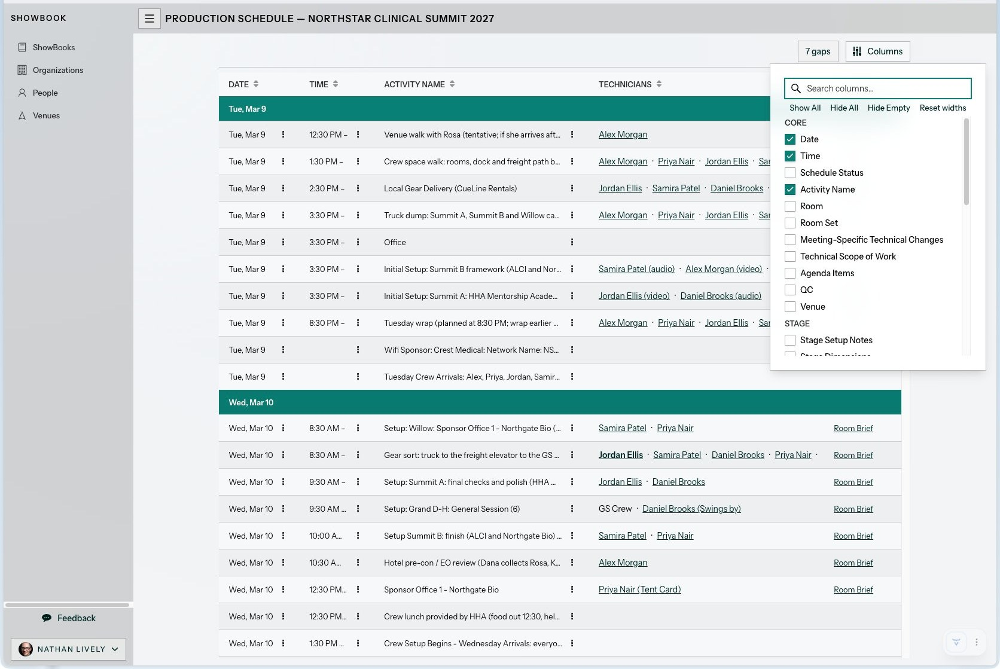

*The production schedule, with dates, times, activities, and technicians, and the columns panel open. All data shown is fictional, from a fake NorthStar Clinical Summit 2027 showbook I built for these screenshots.*

Even a basic question like "When is the event?" turned out not to be basic. Sometimes there was an event but no confirmed date. Sometimes there was a time, but it was tentative. A spreadsheet lets you turn a cell yellow, add a question mark, and keep going. Software that insists on a definite answer can make the job harder. ShowBook tried to handle this with a tentative confirmation status and a flag with a reason on any field, and you can see that flagging in the screenshots below, but it was not perfect, and the rest of the loop around it never worked well enough for day-to-day use.

I started to understand a production schedule differently. For much of its life, it isn't a record of facts. It's a record of what you know, what you think you know, and what you're still waiting to find out.

Then there was the question of which information to trust.

In an October conversation, my customer described receiving a newer email that referred to an older version of a room-allocation document. The email was recent. The information in it wasn't. Simply accepting the latest message would have made the schedule less accurate.

This was the kind of problem I wanted ShowBook to handle: preserve where a detail came from, distinguish confirmed information from guesses, and make conflicts visible instead of confidently overwriting something correct.

That was a real reason to build purpose-made software. It was also a lot of software.

We had a roadmap that went from a skateboard to a scooter, a bicycle, a motorcycle, and finally a sports car. First import the data. Then edit it. Then make bulk changes in natural language. Then bring in transcripts and emails. Eventually, automate the whole production bible.

The metaphor helped us talk about the stages. It also exposed the problem: the thing he most wanted was several vehicles away.

By late summer, we were still working through the basics of making ShowBook a comfortable place to work. In June, the feedback had already been clear: importing a schedule was useful, but without easy editing it was mostly a viewer. By September, he was testing imports and reviewing outputs, but ShowBook still hadn't become the place he did his day-to-day work.

The project was moving. Adoption wasn't.

## Dallas was going to be the test

We had a concrete destination: a November event in Dallas.

I planned to go, work alongside the crew, and see what happened when ShowBook met a real show. Not just another screen-sharing demo. Actual people needing actual information at the moment they needed it.

We worked backward from that. The crew needed room briefs and show handouts before the event. Those weren't decorative reports; they were how people ran the rooms.

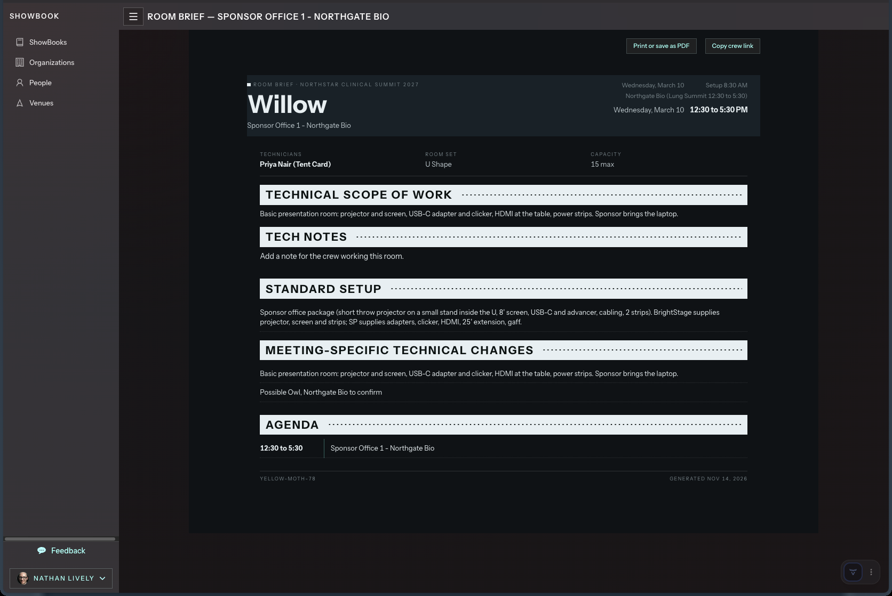

*A room brief for Willow, Sponsor Office 1, Northgate Bio: technicians, room set, capacity, technical scope, and agenda.*

The deadline became November 10, one week before the trip.

On October 31, I sent an update saying I'd imported the full 96-row production schedule and manually entered the contacts from his spreadsheet. I did the work so we could move forward.

There's nothing inherently wrong with doing things manually for an early customer. You can learn a lot that way. But the distinction between helping someone adopt your product and becoming the person who operates it for them matters.

On November 1, my customer explained that learning another system on top of preparing the show was more than he could carry. He proposed that I drive ShowBook for Dallas: handle imports, keep it accurate, and run it onsite. His spreadsheet would stay the source of truth. We could evaluate the outputs with the crew and discuss the future afterward.

That was a reasonable proposal for getting through a show. It was also a different experiment from the one I thought I was running.

I wanted to find out whether a producer would replace part of his workflow with ShowBook. We were moving toward finding out whether I could deliver useful documents while operating ShowBook myself.

A founder-operated service might have been worth pursuing, but it wouldn't have answered the question I started with.

## Meanwhile, he was solving the problem

While I was building, my customer was experimenting too.

He was using Claude to read emails, meeting transcripts, planning documents, and his production schedule. In our October 14 meeting, he showed me how he was comparing information across those sources, finding discrepancies, and preparing updates. By October, Claude could edit his live Google Sheet directly, and he was making edits by dictation, with no manual edits in the schedule since late September.

It wasn't perfect. He still checked its work. Sometimes it misread things. He had to explain his workflow and what belonged in a production schedule. But it worked inside the tools he already knew, and he could change what it did by asking.

If he wanted a new summary, a different way to organize the information, or another cross-check, he didn't need to wait for me to build a feature.

Instant gratification is a helluva competitor.

## Why I still thought ShowBook could win

My customer wasn't the only person assembling his own solution.

In August, I interviewed the owner of a small production AV company in Australia. He was using ClickUp with AI agents to handle work from the initial customer conversation through show preparation and crew documents. He told me he was paying more than $3,000 a year for the platform, including AI usage.

He was getting real value from it. Work that used to take five or six hours could become roughly an hour of generation, checking, and editing. But getting there had meant teaching the system how his business worked: what belonged in a production schedule, how live events ran, and how his company did things.

I heard two encouraging things: someone was already paying for this kind of help, and the general-purpose tool still needed a lot of domain knowledge supplied by its user.

I thought ShowBook could have that knowledge built in. You wouldn't have to explain what a production schedule was before getting to work. And where a rule could be enforced in code, it wouldn't depend on whether the model remembered an instruction.

The promise I wanted to make was: "It can't lie to your crew."

That was the ambition, not something I had proved. The point wasn't that an LLM would never make a mistake. It was that ShowBook would expose uncertainty, preserve sources, and use explicit rules instead of asking a chatbot to improvise every step.

So even as my customer got better results with Claude, I still thought he would eventually switch. His homemade system needed handholding. Mine was supposed to need less.

But there was another lesson from my earlier AV research that I wasn't giving enough weight.

People rarely used their supposedly all-in-one business software for everything. They kept a spreadsheet here, a separate quoting tool there, a custom report somewhere else. Part of SquareWave's business exists because companies want better outputs from the systems they already use.

I'd treated the work of assembling a system as a disadvantage I could eliminate. But it also let people keep the parts they liked and change the parts they didn't. My customer could teach Claude his way of working. To use ShowBook, he would have to learn mine.

Built-in expertise could save him effort. It didn't automatically make that trade worthwhile.

## Did Claude kill ShowBook?

My first instinct was to say this happened overnight. Looking back through our conversations, it wasn't quite overnight. The direction had been visible for a while. What changed was how much my customer could accomplish without waiting for ShowBook.

We discussed a pivot: make ShowBook the structured source of truth and let Claude read and write to it. There were still reasons that might be useful. Reliable structure, business rules, change history, and traceable sources don't stop mattering because a chatbot can edit a spreadsheet. On October 8 he asked for a ShowBook connector that would let Claude read, edit, and track changes in the schedule the same way.

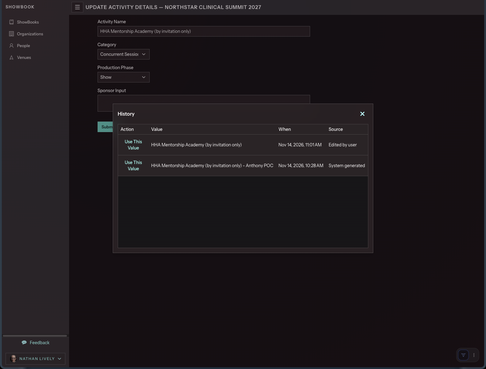

*Every field kept its full history. This activity name was first system generated, then edited by a user, and either value can be restored. That is what made unlimited undo possible: ShowBook was event sourced, so a change added to the history instead of overwriting what was there.*

But those advantages would have to justify moving his information, learning the system, and maintaining another tool.

By early November, when I asked what was still missing, he said he was starting to feel a decent groove and less was keeping him up at night in this area.

I was glad the work was getting easier for him, even though it made the case for my product harder to see.

The problem hadn't been fake. The solution no longer needed to be mine.

I think Claude helped make ShowBook unnecessary for the one customer whose demand I had actually established. That's a narrower claim than "AI killed SaaS," and a more useful one than pretending technology had nothing to do with it.

ShowBook was built around using language models to do work that would previously have been difficult to automate. The same improvement that made my idea possible also made it easier for my customer to assemble a solution without me.

But I can't honestly put everything on Claude.

The product wasn't ready quickly enough. We spent months on the prerequisites. I had one paying customer, not evidence that a whole market wanted the same thing. I also let a small, valuable tool grow into a much larger system.

I always wanted a micro-SaaS business: something narrow enough for one person to build, sell, and support. I didn't set out to replace an event producer's entire working environment. Yet a series of reasonable decisions took me closer and closer to doing that.

Could faster delivery have changed the outcome? Maybe. I don't get to run the alternate version of the experiment. It's also possible that getting him into ShowBook sooner would only have postponed the same question: why use this instead of improving the workflow he already has?

I'm not going to turn a business I couldn't make work into a confident prediction about everybody else's business.

I decided to stop rather than invent another reason to keep building. I shut ShowBook down before the Dallas field test. The event we had been building toward would go ahead without it.

## What I want to remember next time

**A payment matters. So does what happens after it.**

The deposit was a meaningful signal. Someone was willing to spend money on the problem and trust me to work on it. I don't regret taking that seriously. But it wasn't proof of repeated use, a successful switch, or demand from a second customer. I need to keep those questions separate.

**Feedback and adoption are different kinds of progress.**

A thoughtful customer can give you enough good ideas to keep you busy indefinitely. There are still more than a hundred open issues in ShowBook. Many are genuinely good ideas. The existence of more useful work does not tell me whether I should do it.

**Compare against the customer's current alternative, not the one from the first interview.**

When we started, I was competing with hours of manual synthesis and formatting. By the end, I was competing with a person using Claude in a familiar spreadsheet. The comparison changed while I was working on the product.

**Technical advantages have to earn the switch.**

I still care about reliability, source tracking, and making uncertainty visible. But "this could eventually be more robust" doesn't pay for the work of learning it today. My customer wasn't failing to appreciate good engineering. I hadn't made the overall trade worthwhile enough.

**Put a boundary around the next experiment.**

Five interviews was a useful boundary for discovery. I needed an equally clear one around building: what behavior am I trying to observe, by when, and what will I do if it doesn't happen? Dallas gave us a date. It didn't keep the definition of the test from changing.

If I went back, I would push much harder on adoption. Three months in without anyone using the product for their actual work should have been a big red flag.

**Remember what I want from the work.**

I want income, independence, useful work, and people who care about what we're making together. None of those are unreasonable things to want. But enjoying the collaboration isn't evidence that the business works, and ending the product doesn't make the collaboration worthless.

## What's next?

I don't know yet.

I could revisit GainGuardian if better tools help with the technical obstacles and I can develop a clearer path to market. I can help businesses with AI and automation, since I've become pretty obsessive about both. I can also stop trying to turn every useful skill into another company for a while. I'd probably have more free time and more money. Don't ask me how much I paid for LLMs to build ShowBook.

Right now, I don't want to rush into a new idea just to avoid feeling disappointed about this one.

My first reaction was that I'd spent six months and had nothing to show for it. That isn't quite true. I learned a great deal about building software, working with a paying customer, and the difference between making progress on a product and making progress toward a business. I also made a friend.

I wish those things had come with a sustainable income. They didn't.

The part I will miss most isn't closing issues or planning the next feature. It's sending someone a question about a problem we both cared about and knowing I'd get a thoughtful answer back.

## Update, November 15, 2026: what the comments taught me

I posted this on Indie Hackers on November 14, and by midday on November 15 it had 22 upvotes and 49 comments. I replied to them all, and the replies changed how I think about a few parts of this story. I am adding this update instead of rewriting the post, because I want the original to stay as a record of what I thought when I shut ShowBook down.

Thank you to everyone who read it that closely, especially Chester13, Sarmed Shafi, Sumedh Kolte, Ilia Pomirchi, Sama, Alex Aramendi, lukaslabs, zig, maildoer, duranlautaro, danielserafimov, lameiras, Noah Salas, and Sara. The full thread is here: https://www.indiehackers.com/post/i-built-a-saas-for-six-months-my-paying-customer-found-another-way-with-claude-and-google-sheets-pgxVdxvdwnsIAoNDubhW

### Tentative data was not a blind spot. The loop around it was.

In the post above I wrote that a spreadsheet lets you turn a cell yellow, add a question mark, and keep going, while software that insists on a definite answer can make the job harder. That is true about software in general, and it is a problem we talked about from the very beginning, since we first discussed software a couple of years ago.

I should have said more clearly that ShowBook was built for it. Every activity had start and end times and dates, with a confirmation status you could set to tentative, with a reason, for the whole activity. You could flag any field with a reason, and that flag showed in the production schedule, in every input form, and in the pre-meeting readiness report. The classic case was a client who calls about a show next summer with no dates yet, and most software has no way to enter a range of tentative dates. We knew that, and we tried to handle it. You can see the flagging in the screenshots below, "Flagging a field" and "A flagged field."

It was not perfect, and a yellow cell is still simpler in a lot of cases. But the gap was not that I had missed uncertainty. The gap was the rest of the loop around it: import, editing, and re-import, working well enough that he could live in that tentative state day to day instead of in Sheets.

### He did name what he needed. I missed the part he never quite named.

Early on, what he needed did move. In July it was setup and strike rows for each show. In August it was a readiness report for what was missing. In September it was handouts that could get paper into a tech's hands a week or two before Dallas.

It got clear on August 31, when he sent a Dallas list, and on September 3 he gave me the test in plain words: if he could sit down and work in it for a day without reaching for Google Sheets, we were good to go.

What neither of us quite named was that he was still doing all his edits in Google Sheets. So the real test was not just import. It was import, plus editing in ShowBook that was at least as fast as Sheets, plus re-import that was upload and done. On November 1 he spelled that test out: no review step, no list to check, nothing to fix by hand first. Changing a match field created a duplicate, a blank cell kept the old value live on the public Room Brief, and deleted rows stayed until removed by hand. Until that worked, he had a good reason to stay in Sheets.

Trust, for him, was also provenance. On October 12 he said what he trusted was every change carrying where it came from, its history, and an undo option, more than the approval click itself. He approved on Claude's side before anything wrote to ShowBook, and wanted stop-and-ask for source disagreement, verified or locked items, and anything flowing into a client-facing output.

### Sheets never failed him. That matters.

Several commenters asked the question I should have asked myself more directly: was there a specific moment where Sheets hurt him, version confusion, a missed change, formatting time, or did it genuinely cover the whole job?

I went back through my emails and meeting notes before replying, and I do not have a failure story to give you. There is no version confusion incident or missed change I can point to. The closest is a stale case from October 14: a planner sent an email referencing a space allocation from May, not July, and he had to catch that it was old. Claude was already auditing his planning book, tracker, and production schedule to make sure they were all in sync.

So the honest answer is that Sheets plus Claude covered the job well enough, for one person, on one event at a time. The pain was effort, not failure. Building handouts by hand was hours per show, and that is where things get missed. Keeping everything current across 50 meeting transcripts and email chains took a lot of time and energy to keep at a high quality.

That changes the lesson. I was not fixing a crash. I was trying to remove effort, and I had to make the whole trade worthwhile enough to justify learning a new tool, moving his information, and maintaining another system. I did not.

### The change that made Claude win was specific, and recent.

On October 14 he told me the Google Sheets connector that let Claude edit his live sheet directly had launched about two weeks earlier, and once that launched, it changed the game. Before that Claude had to generate a sheet, it could not work in the sheet, and controlling Chrome was slow.

After that, he could dictate an edit, approve it on Claude's side, and have it land in the live schedule. By October he was making every edit through Claude by dictation, with no manual edits in the schedule since late September. He still checked the work. He spot checked five or six lines and then approved if he trusted the source, checked more if a source was notoriously wrong, and told Claude to double check its work and re-audit what it had just done. On September 18 he said the material was about 80 percent accurate, with gear and IO lists not yet carefully checked.

That is why the comparison changed while I was building. I started competing with hours of manual synthesis and formatting. By the end I was competing with a person using Claude in a familiar spreadsheet, in a tool he already trusted for the day-to-day work.

The homemade version was not free, either. That is a fair correction from Noah Salas, and I should have named it in the post. Reading up to 50 transcripts plus email chains for an event, and cross-checking them against the schedule, is a lot of AI work. If that runs on a flat monthly plan, the cost is invisible, so the homemade version looks free next to a subscription. If show week pushes it past the plan's usage limits, it either stops or starts billing by usage. He was on a Claude Max subscription, and I did not ask him to compare that cost to ShowBook's price. I should have.

### The crew side is still unsolved, for Claude plus Sheets too.

No one besides him had used ShowBook. Crew use was planned for Dallas, with read-only crew links and a handful of fields a tech could update on site. I know most of his team, I have worked events with them as a technician in previous years, including the Dallas event, so this was not a case of me never meeting them. The missed step was narrower: I never sat down with his teammate about ShowBook specifically, or asked him to try it on one of his own events.

He is aware of that part now, too. In our last conversation he told me he is happy with his workflow, and now he is trying to figure out how to deploy and share it with everyone else in his company so they can all use it as well.

That is the part where other people touch the work, and it is still unsolved. A spreadsheet plus Claude can copy almost any workflow that lives inside one person's head and one file. What it does not replace well is a whole team relying on the same schedule, with permissions and history. If I ever revisit this space, that is the buyer I would talk to first, not the owner of the spreadsheet, but the second and third people who need the same data at the same time.

On October 8 he had asked for a ShowBook connector that would let Claude read, edit, and track changes in the schedule the same way Claude was already editing his live sheet. That direction, do not compete with Claude, let Claude do the work inside the tool, is closer to what he wanted than the product I built.

### The adoption test I should have run

If I did it again, I would define the first adoption milestone the way several commenters put it: one real job the customer completes without me operating the tool, with his familiar spreadsheet allowed to stay in place.

His version of that test, on September 3, was if he could sit down and work in it for a day without reaching for Google Sheets. I did not run that test early enough, and I kept building the prerequisites first. Three months in without anyone using the product for their actual work should have been a big red flag, and I wrote that in the post above. The comments made it sharper: the test is not a deposit, a useful conversation, or a list of feature ideas. It is one real job, completed without the founder in the room.

I still do not know what is next. I do know I want the next experiment to have that test in front of it from the start.

### If I did it over again

Writing this post and reading the comments has left me with two things I would do differently.

First, I would try to replace Google Sheets as quickly as possible. As long as Sheets stayed the source of truth, every import was already going stale, and ShowBook could only ever be a viewer. That is really what his September 3 test was asking for: a day of work without reaching for Sheets.

Second, I would get more people using it, not just him. That is the biggest difference between my customer using Claude by himself and an app like ShowBook. Claude is a great tool for one person. ShowBook was meant for collaboration, and it only earns its keep when a second and third person are in it, seeing the same schedule, contributing to it, and relying on the same history.

There is another path I keep coming back to, and I am not sure if it is the right one: integrate with Sheets better instead of replacing it. Let Sheets stay where it is, and have ShowBook add structure, history, and crew views on top of it. Replacing Sheets and integrating with it are almost opposite bets, and they would pull in different directions as a main strategy. But integrating first and replacing later might have been a way to get him, and then his team, into ShowBook sooner, instead of asking him to make the whole switch at once.

## ShowBook, in pictures

ShowBook is shut down now, so these screenshots are the record of what it looked like to work in. All of them show the same fictional showbook, a made-up NorthStar Clinical Summit 2027, built from anonymized data so no real customer information appears anywhere.

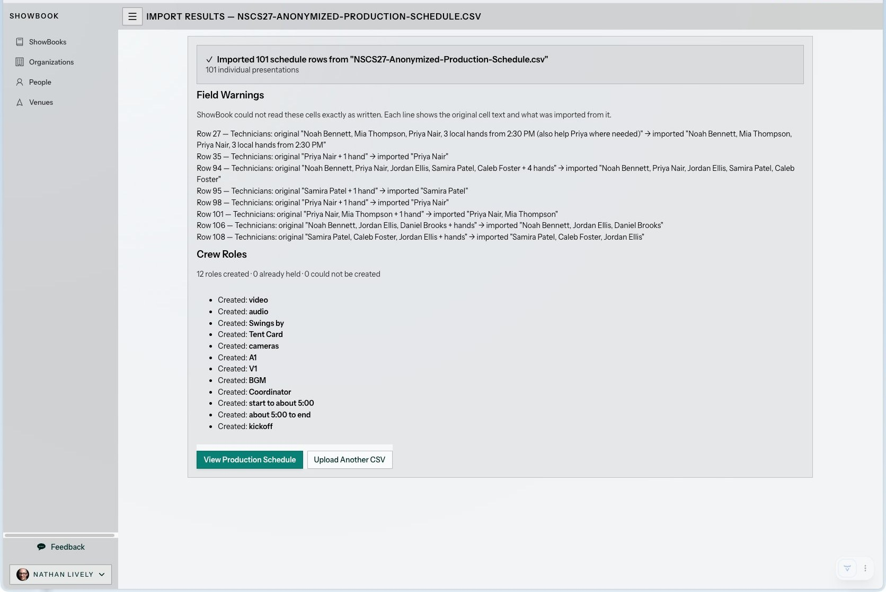

*Importing the fictional schedule: 101 rows in, with field warnings showing exactly what ShowBook could not read as written.*

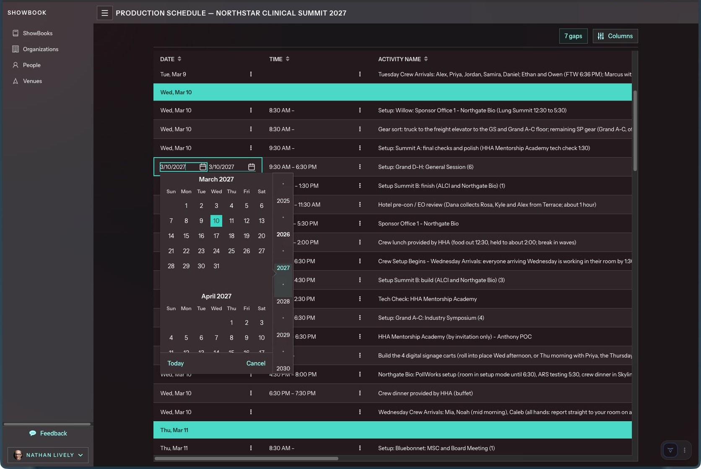

*Editing a date in the schedule grid.*

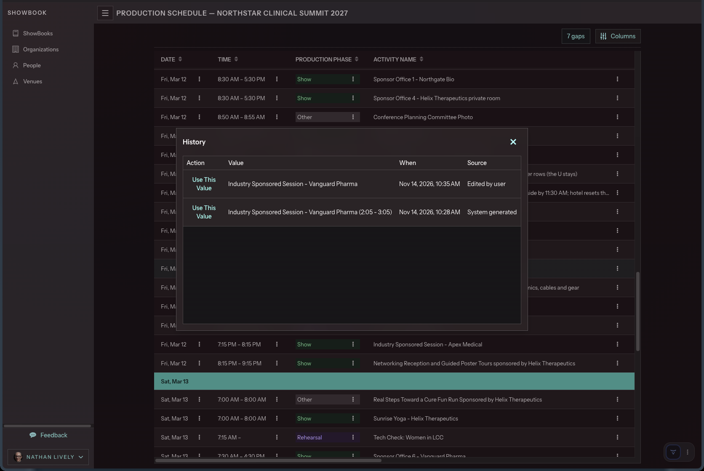

*The same history view on a schedule row: the system-generated name, then the edited name, each restorable.*

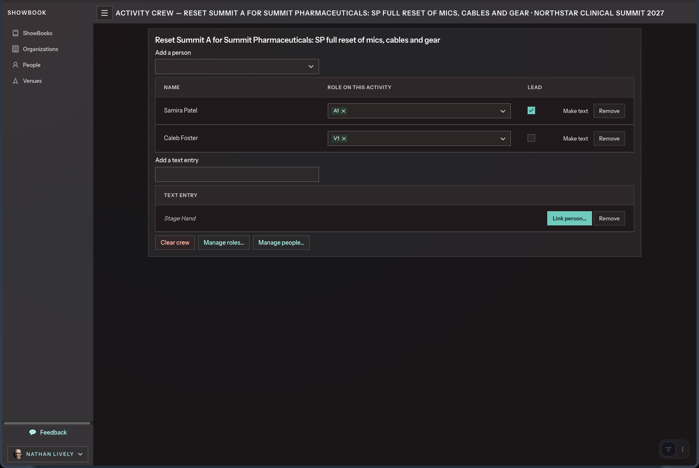

*Assigning crew to an activity, with roles and a lead.*

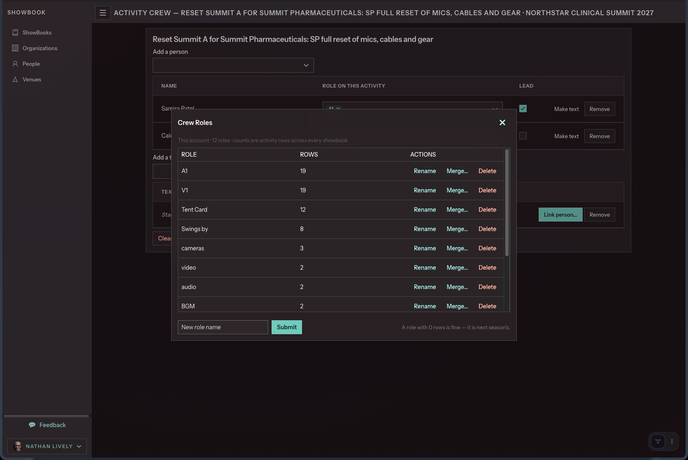

*The twelve crew roles in this showbook, with row counts across every showbook in the account.*

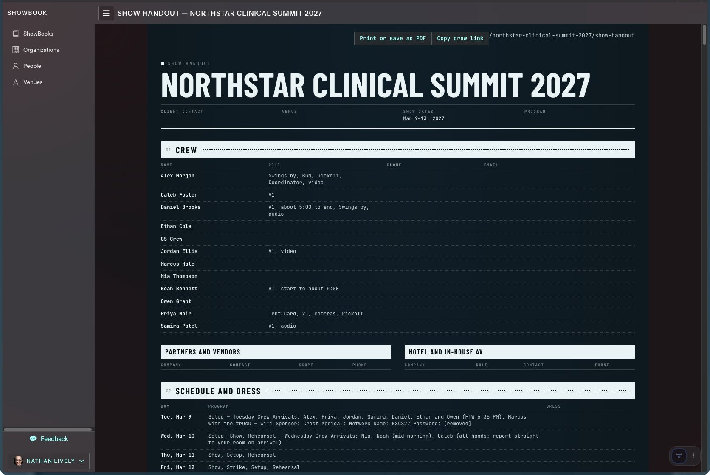

*The show handout: crew, roles, and contacts up top.*

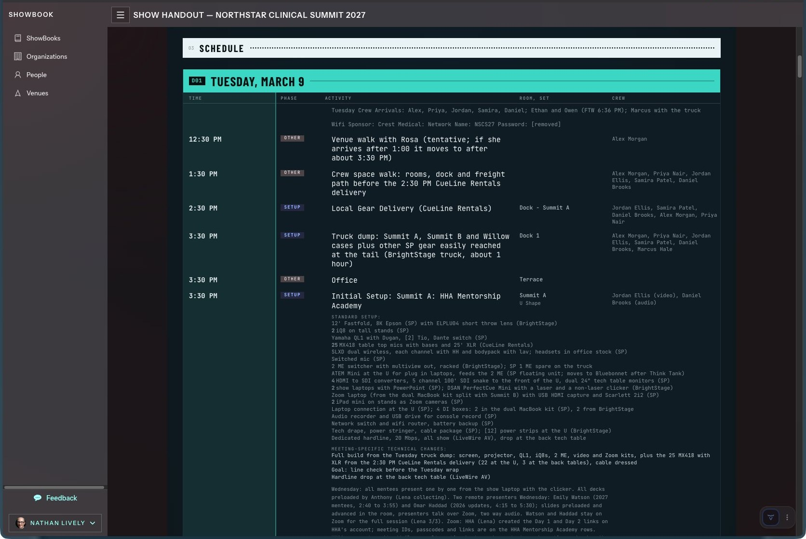

*The show handout's day-by-day schedule, Tuesday, March 9.*

[Download the full 30-page show handout (PDF)](https://raw.githubusercontent.com/LiveNathan/blog/main/assets/images/2026/Show_Handout___NorthStar_Clinical_Summit_2027.pdf)

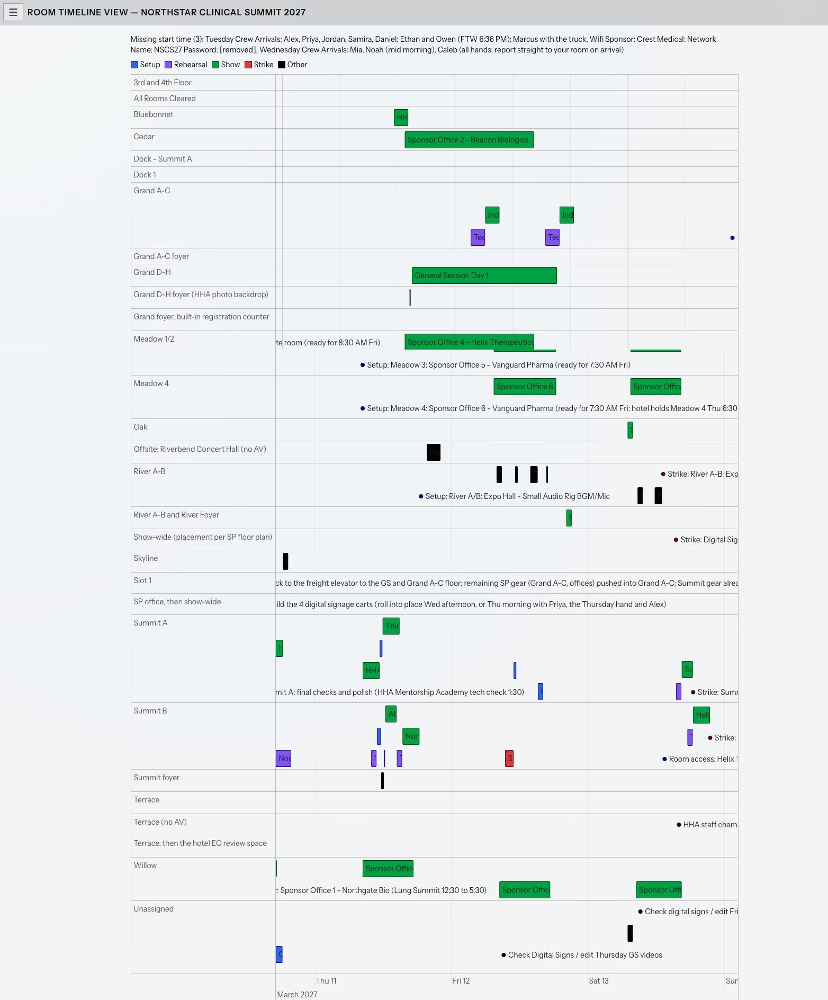

*The room timeline view: every room across the week, color-coded by production phase. Best viewed full size.*

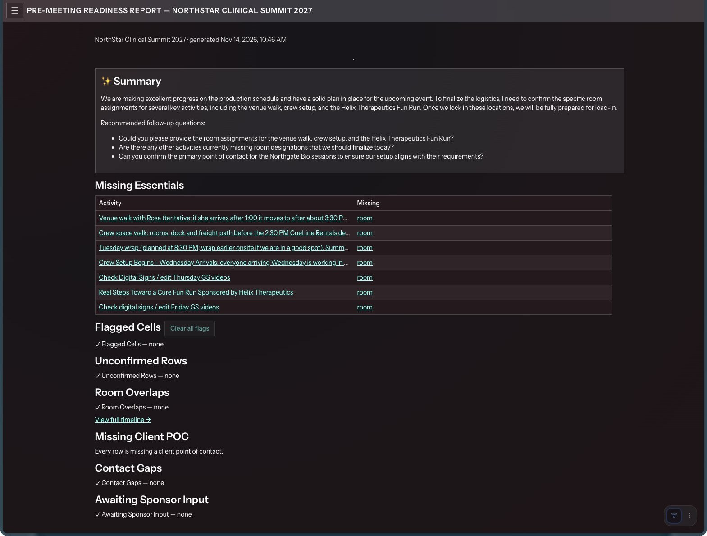

*The pre-meeting readiness report: missing essentials, flagged cells, and overlaps, in dark mode.*

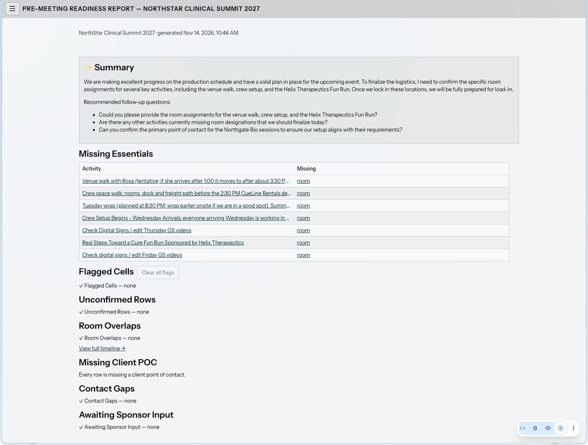

*The same readiness report in light mode.*

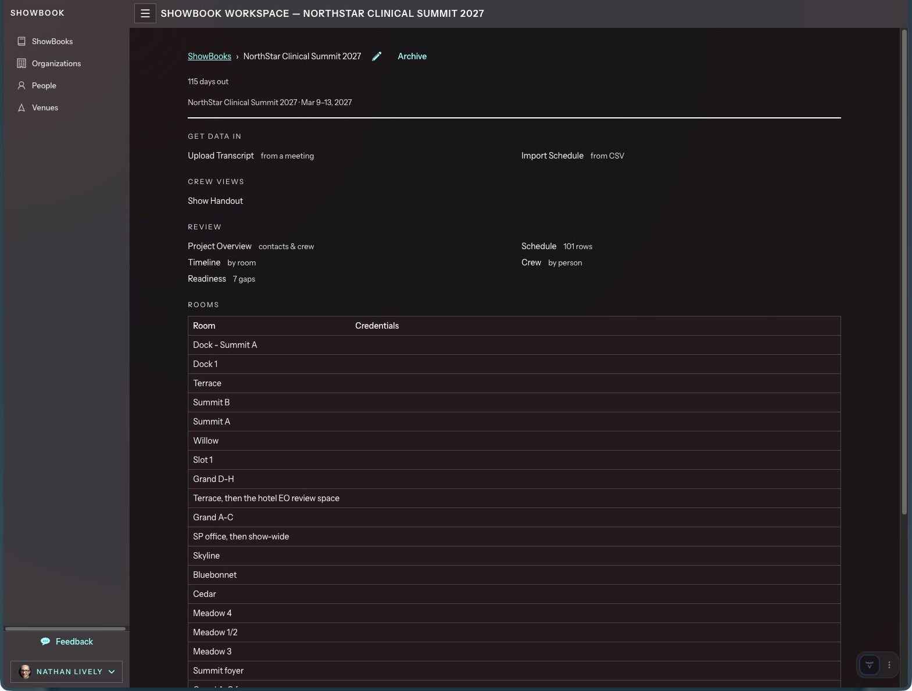

*The showbook workspace: rooms, credentials, and links to every view.*

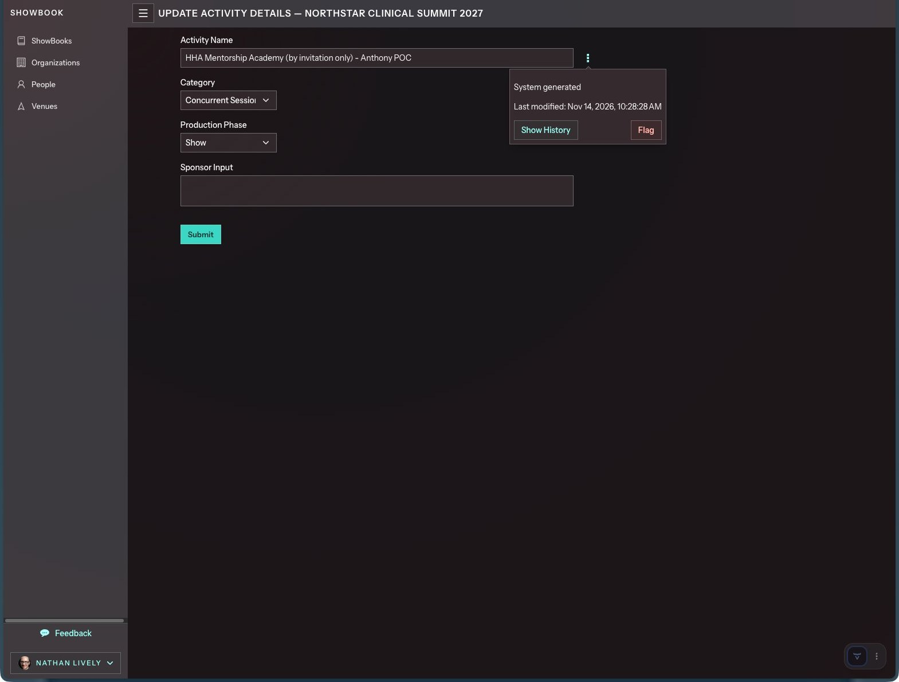

*A system-generated activity name, with its source and last-modified time shown.*

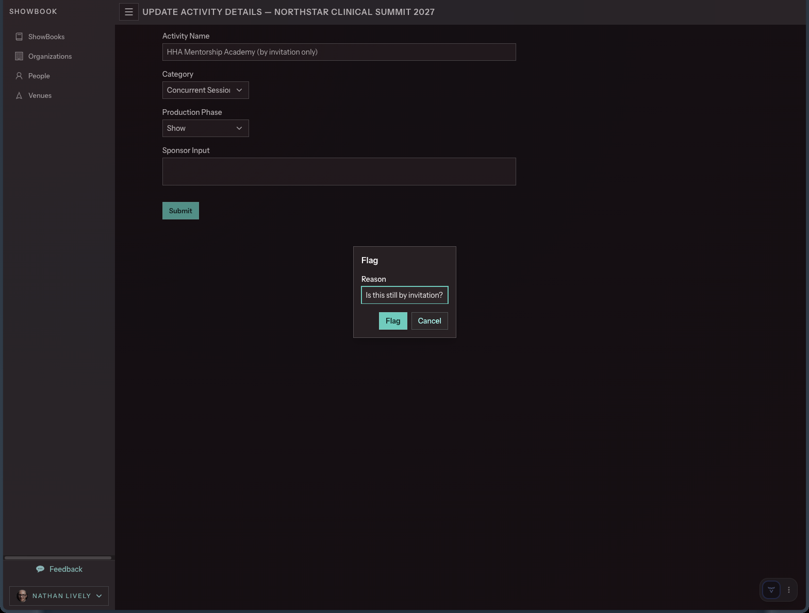

*Flagging a field for follow-up, with a reason.*

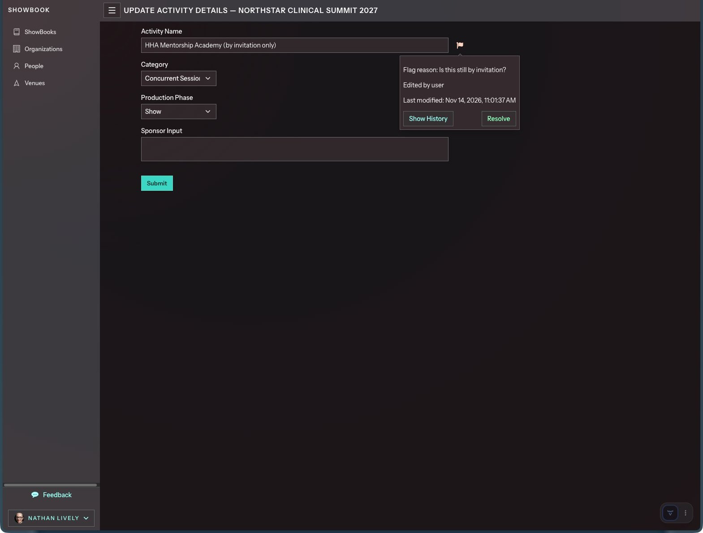

*A flagged field, with its reason, source, and a Resolve button.*
